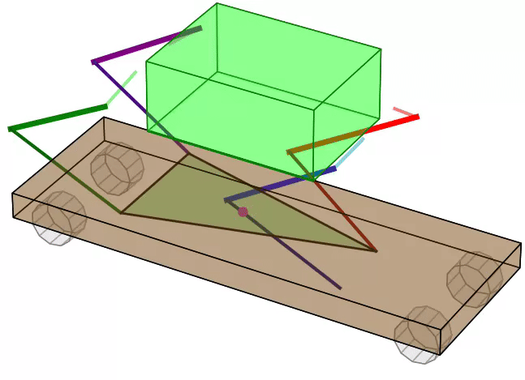
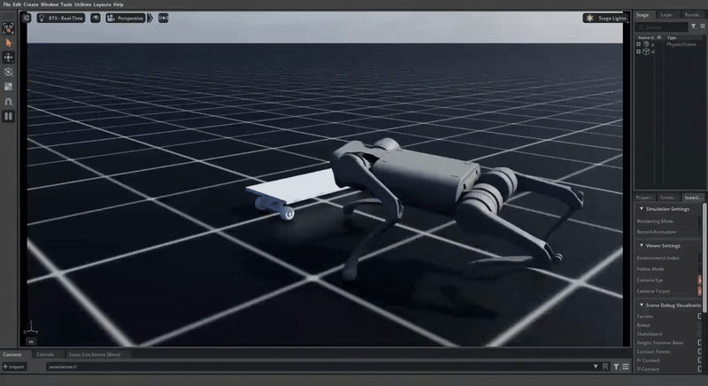

# Quadrupedal Skateboarding

Demos for *The robot goes skateboarding*.

### Propulsion

<table>
  <tr>
    <td align="center"><b>Simulation</b></td>
    <td align="center"><b>Real robot</b></td>
  </tr>
  <tr>
    <td></td>
    <td></td>
  </tr>
  <tr>
    <td></td>
    <td></td>
  </tr>
</table>

### Steering

### Mounting (simulation)

[Mounting code](https://github.com/dancher00/quadruped-skateboard-mounting) · [Paper](https://arxiv.org/abs/2505.06561) · [License](LICENSE)
